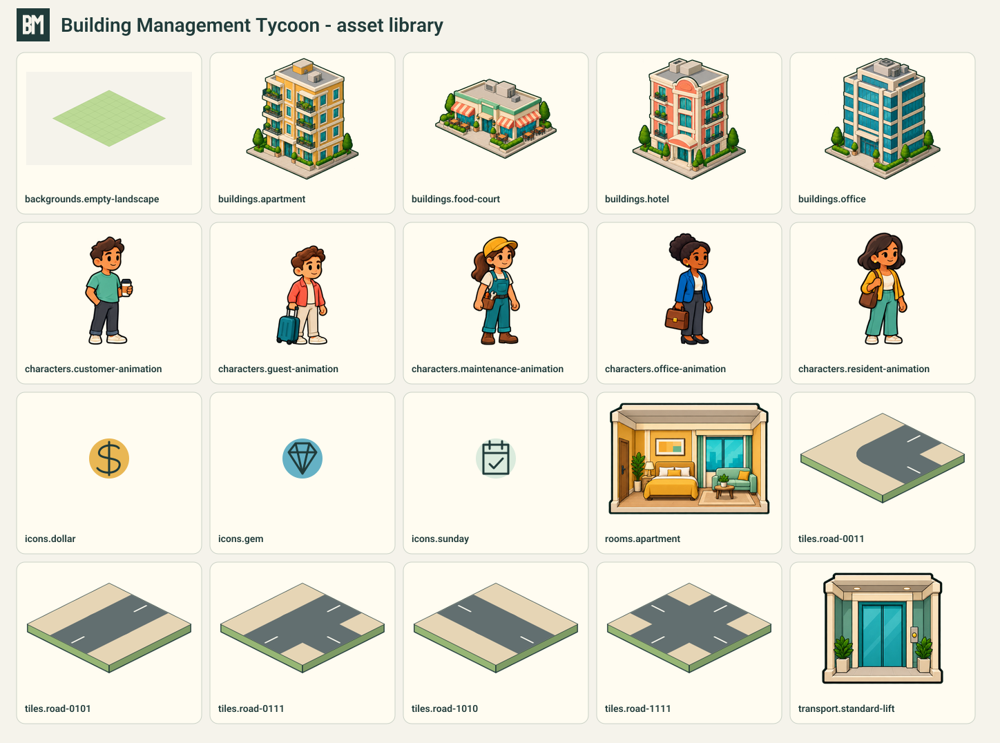

# Repository game assets

The current documented game now has a runtime asset pack in `assets/game/`, based on the approved 2026-10-11 artwork, the unchanged BM tower mark and the shared palette in [DesignKit.md](DesignKit.md). The original approved atlases stay in `design/tycoon/assets/`; rejected historical boards in `design/system/` are not runtime assets.

## Included files

| Family | Files | Coverage |
| --- | ---: | --- |
| Brand | 9 | Defined square BM at 24/32/48/64/128/256/512/1024 px; outlined game-title lockup |
| Backgrounds | 8 | Populated menu reference, empty portrait/landscape land, five phase overlays |
| Buildings | 31 | Four approved exteriors; lobby/floor/roof pieces for each type; three luxury previews per type; three construction stages |
| Rooms | 11 | Four approved furnished cutaways, four vacant structural shells, selected/blocked/vacant overlays |
| Characters | 11 | Six approved role/pose exports; five registered animation sheets |
| Tiles | 23 | Land, placement states, all 16 road-connectivity masks, two crossing orientations |
| Transport | 11 | Approved stairs/lifts/parking, empty parking, car, shaft, two carriages and two door animation sheets |
| Icons | 35 | Currencies, building types, parking, luxury, happiness, maintenance/tax/synergy, calendar/Sunday, navigation, audio and feedback |
| Effects | 3 | Eight-frame dust, financial-closing coin and lift-arrival sheets |
| Decorations | 6 | Tree, hedge, planter, bench, streetlamp and table set |
| Audio | 10 | Three 20-second district music loops, city ambience, lift ding, financial closing, hammer, drill, confirm and error sounds |
| **Total** | **158** | PNG/WAV runtime files, plus `manifest.json` |

Licensed local Roboto and Noto Sans Thai fonts are separately supplied in `assets/fonts/` with their OFL notices. The title asset outlines bundled Roboto rather than copying the workstation's Trebuchet font. This follows the runtime fallback already documented in [Setup.md](Setup.md).

## Runtime catalog and animation contract

`assets/game/manifest.json` lists IDs, paths, dimensions, source/output SHA-256 hashes, pivots, frame sizes, playback sequences and provenance. All files are declared in `pubspec.yaml`. Generated `lib/app/production_assets.dart` provides stable Dart constants; `GameAssets` now points the launch screen and branding at runtime exports rather than design-source atlas paths.

Text-source hashes normalize CRLF to LF so Windows/Linux checkouts validate identically; raster/audio output hashes and their byte counts remain exact binary checks.

- Each actor has **16 poses**: idle frames 0–3 at 4 fps, walking frames 4–11 at 8 fps and stair frames 12–15 at 6 fps. Resident, guest, office tenant, customer and maintenance identities follow the approved people atlas.
- Character sheets use **256 × 384** frames in a 4-by-4 grid. One scale per actor and a shared foot baseline at y=364 prevent independent frame resizing. The exporter finds actual transparent gutters in the generated source, rather than assuming perfect quarter boundaries and cutting feet off.
- Rightward frames are the source; leftward playback uses `flipX`. Render around the declared foot pivot. These are floor/stair-facing animations, not an eight-direction city sprite system.
- Standard/executive lift door sheets contain five 192-by-320 frames, with opening/closing order at 8 fps. Engine movement should translate the independent carriage in the shaft; no artificial extra floor is encoded in an image.
- Dust/coin/arrival effects use eight 128-by-128 frames. Gameplay respects `loop: false` for one-shot effects; the asset gallery repeats them for review. Coin feedback plays after cash settlement, including Sunday apartment payment, never on daily unpaid rent accrual or taps.
- Respect reduced-motion preferences by holding a neutral frame and omitting optional effects. Audio playback still needs app integration, mute controls and saved preferences; including WAV files does not enable autoplay in the game.

## Geometry and game rules

Road art supports every four-way connectivity combination, with bits 1/2/4/8 representing north/east/south/west in the tile's local plane. The apartment starter renders all road masks using the shared 256-by-128 art plane and pivots. Gameplay uses the user-approved free one-tile ring on unbounded land; this rule comes from [Economy.md](Economy.md), rather than the art dimensions. Roads remain outside a building's capacity footprint.

Exterior structural pieces repeat with a 48-pixel floor step and remain available for future composition. The user explicitly requested the approved exterior image on 2026-10-14: the apartment map now uses `buildings.apartment` directly, preserving its square aspect ratio and bottom-centre pivot. Its projected width follows the saved plot's bounding width; its bottom meets the plot's projected bottom. This supersedes the earlier requirement to compose the starter exterior from roof/facade textures. The sprite's illustrated storeys do not add playable floors or capacity. Luxury previews remain gated by their catalogs. Room, parking and lift assets use front cutaway projection. Draw B1/B2/B3 labels and capacity numbers natively. Parking illustration bay counts are not the quota formula.

Empty backgrounds contain no buildings or roads; populated district art is only for menu/promotional use. The original eight-by-eight bootstrap viewport has been replaced with a pannable unbounded tile plane. Phase tint layers apply to world artwork, leaving HUD text readable. The Day overlay is intentionally fully transparent.

Decorations and luxury visuals do not establish prices, unlocks, income boosts or upkeep coefficients. Malls, VIP tenants and broader city content remain future scope. No accounts, backend, ads or online purchases were introduced.

## Sources and regeneration

Asset tooling lives in `design/production/`: vector authoring/exporter, original audio synthesizer, outlined-font helper, five imagegen source sheets, exact prompts, validator, interactive gallery and contact sheets. Runtime PNG exports are derived from native SVG geometry or approved/reference-guided raster art. Audio is original procedural PCM synthesis with no stock samples, recorded speech or downloaded music.

See [production-tool README](../design/production/README.md) for regeneration commands. Imagegen prompts are in [prompts.md](../design/production/prompts.md). Existing approved atlas prompts remain in [the tycoon design sources](../design/tycoon/prompts.md). The BM master was not changed or regenerated by imagegen.

## Review and validation

The asset validator checks source/output hashes, image decoding, manifest paths, Flutter declarations, frame indices, empty/clipped character frames, all road masks, building modules, phase coverage and PCM audio format/peaks. Flutter also tests loading every catalog file through `rootBundle` to catch packaging omissions. The CI workflow runs the asset validator before Flutter checks.

Contact sheets and the local gallery provide visual/motion review; data validation alone does not prove animation quality. The apartment starter now uses the approved apartment exterior directly, draws road connectivity and phase overlays, and plays resident idle frames from catalog timing in occupied rooms. Respect reduced motion. Full walk/stair/lift/effect and audio integration remain pending. Gameplay and validation are recorded in [Gameplay.md](Gameplay.md) and Setup.md.

