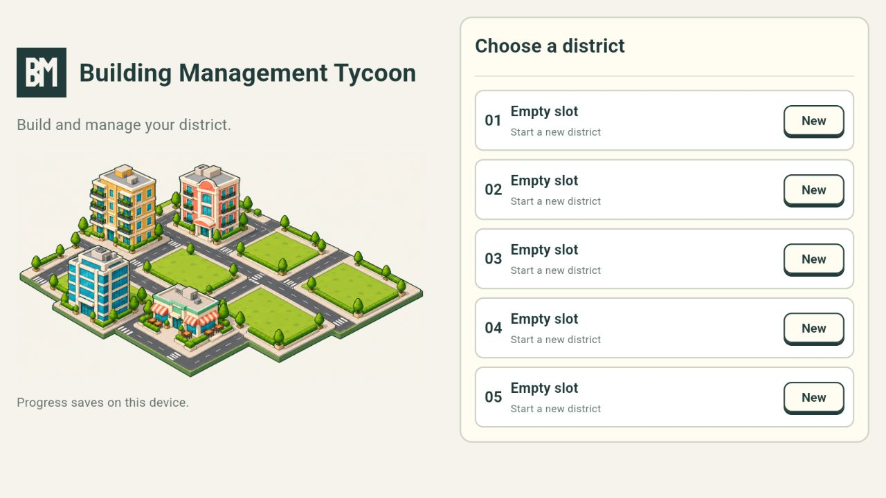

# Project setup

## Pacing and pinch validation — 2026-10-14

The feedback update uses 5-second phases and a 25-second day, concise status copy and continuous focal-point pinch zoom. Formatting, Flutter analysis and all 43 tests pass; the final targeted repository and multi-pointer gesture checks also pass. The Web build includes 201 offline resources. Browser review on an isolated localhost origin confirmed the faster running calendar, shorter construction labels and normal 2 × 4 mouse placement/cost review. Pinch behavior was verified with simulated two-finger Flutter events; physical-device pinch was not tested. Android debug compilation was attempted again and remains blocked by the missing Android SDK.

## Floor navigation validation — 2026-10-14

This Windows workstation installed the pinned SDK using `tool/bootstrap.ps1`; an initial dependency-cache rename was denied by Windows and succeeded on the bootstrap retry. Formatting (33 files), analysis, all 35 tests, asset validation (158 assets/124 frames) and the final offline release Web build (201 resources) pass. An Android debug build was attempted and reports **No Android SDK found**. The older machine-specific Android setup below does not apply to this workstation. Android device execution remains unverified. See `PROJECTS.md` and Gameplay.md for browser review of the new floor navigation.

GitHub accepted source commit `792d3b2`. Its [Actions run](https://github.com/norfabagas/building-management-tycoon-game/actions/runs/38508472461) returned `startup_failure` with zero jobs, so it supplies no remote build/test evidence. The API response did not establish the startup failure's cause; the local checks above remain the validation evidence.

## Approved source

The user approved the current [Canva artwork and game kit](https://www.canva.com/d/51ESDDCqVSdEOVT) on 2026-10-11. Follow [DesignKit.md](DesignKit.md) and preserve the BM mark from `design/brand/`. The game contract remains [Project.md](Project.md), [Platform.md](Platform.md), [Rules.md](Rules.md), [Logic.md](Logic.md) and [Design.md](Design.md).

## Toolchain

- Flutter 3.47.7, revision `abaf9c523780a608bd46686fd5e53740a07077f8`.
- Dart 3.13.5. The SDK pin is in `toolchain.json`; `pubspec.lock` pins resolved package versions.
- Android and Web only. Android application ID: `com.norfabagas.building_management_tycoon`. Android minimum API 24; compile/target values follow the pinned Flutter template.
- Java 21 for Android builds. Android SDK platform 36, build tools and the Flutter-selected NDK are development prerequisites.

This Windows workspace installs Flutter under ignored `.tools/flutter/`, without adding it to the user's PATH. The wrapper, bootstrap and Web build use a project-local `.tools/pub-cache/`. This keeps Kotlin plugin source files on the same drive as the project: the initial Android build failed when Kotlin tried to relativize C: dependency paths against the D: workspace. The generated failed Kotlin cache was moved to an ignored backup before retrying; no user save data was removed.

The existing Android Studio configuration pointed to a missing folder. Setup corrected the Flutter tool's local configuration to the installed Studio at `D:/Work/Android`, SDK at `D:/Work/Android-Sdk`, and JDK 21 at `C:/Users/bgsno/.jdks/openjdk-21.0.1`. These machine paths are not checked into Gradle properties.

Android command-line tools 23.0.0 were installed from Google's SDK repository, with the ZIP checked against its published checksum. Flutter installed NDK 28.2.13676358 using the existing accepted Android SDK license. `flutter doctor -v` confirms Android and Chrome toolchains are ready.

The project also sets `kotlin.incremental=false` and `kotlin.compiler.execution.strategy=in-process` in `android/gradle.properties`. A second build retained failed registrations in the old Kotlin daemon after the cache move. The project-local compiler settings fixed that failure; ordinary Gradle task caching still applies. See [Kotlin compilation settings](https://kotlinlang.org/docs/gradle-compilation-and-caches.html).

Installation follows [Flutter's manual setup](https://docs.flutter.dev/install/manual). Fresh dependency and SDK installation requires connectivity; running the packaged game does not require a backend.

## Bootstrap and run

From the repository root on Windows:

```powershell
./tool/bootstrap.ps1
./tool/flutter.ps1 run -d chrome
./tool/flutter.ps1 devices
./tool/flutter.ps1 run -d <android-device-id>
```

On another workstation, use the version in `toolchain.json`, install the Android SDK/JDK, and run `flutter doctor -v`. A globally installed matching Flutter SDK also works. Do not run `flutter create --overwrite` over the authored application or documentation.

## Checks and builds

```powershell
./.tools/flutter/bin/cache/dart-sdk/bin/dart.exe format --output=none --set-exit-if-changed lib test tool
./tool/flutter.ps1 analyze
./tool/flutter.ps1 test
./tool/flutter.ps1 build apk --debug
./.tools/flutter/bin/cache/dart-sdk/bin/dart.exe run tool/build_web.dart
```

For a global SDK, use `dart` and `flutter` in the equivalent commands. GitHub Actions runs format, analyze, tests, the offline Web build, and an Android debug build. Store signing is not configured. Manual Netlify Web hosting is recorded in [Deployment.md](Deployment.md).

Web output is `build/web/`. Serve that entire directory from HTTPS, or localhost during development. `tool/build_web.dart` disables the Flutter resource CDN, generates a versioned offline asset manifest, and includes a service worker. After the initial load and cache installation, the app can reload without the host being reachable. Updates wait for the previous service worker's clients to close. Direct `flutter build web` omits this offline packaging step. Local profiles are tied to the browser origin and can be removed by browser storage clearing.

The native Android app bundles its assets and fonts. Release application permissions contain no Internet permission. Flutter's debug/profile manifests allow network access for development tools. Android backup and transfer exclusions keep profile metadata local.

## Architecture

The setup uses MVVM with Flutter `ChangeNotifier`, without an extra state-management package.

| Location | Responsibility |
| --- | --- |
| `lib/app/` | App composition, generated runtime asset catalog, approved paths and shared theme |
| `lib/domain/` | Profiles, starter catalog, footprint/roads, full snapshots and deterministic district simulation |
| `lib/data/` | Profile metadata plus transactional SQLite/IndexedDB game repository |
| `lib/features/profiles/` | Five-slot view model, profile selection and naming |
| `lib/features/district/` | District view model, HUD, unbounded map, build review, building rooms and finances |
| `lib/shared/widgets/` | Defined BM title lockup and shared actions |
| `test/` | Save safety, concurrent reservations, clock/construction/rent, offline parity and responsive build/room flows |

`PreferencesSaveStore` retains **profile metadata only**: slot, trimmed district name and creation time, under the existing schema/key. Its serialized slot-creation rules and corrupt-data preservation remain. `GameRepository` now stores complete version-1 game records separately in Sembast transactions, backed by SQLite on Android and IndexedDB on Web. Each transaction loads the latest snapshot, applies elapsed phases and a validated action, then commits before the view model publishes it. The wallet, rent ledger, closing ID, orders, buildings and watermark are saved together. Road tiles are derived deterministically from saved plots. Existing metadata-only profiles initialize an empty $40,000 game once at first gameplay load. No reset/delete action exists. See [Gameplay.md](Gameplay.md) for persistence, migration and browser storage limitations.

## Current application scope

Implemented: branded responsive profiles, exactly five local slots, district naming, legacy profile preservation, transactional full-game saves, a $40,000 wallet, unbounded pannable land, manual apartment footprint selection with road preview, cost review and reservations, automatic road rings, queued Noon payment, two-day shell plus one-day B1 construction, parking-gated Morning admissions, room vacancy management, Sunday apartment rent, daily parking/upkeep/tax, finance statements and uncapped offline catch-up. A new district contains no sample buildings; launch art stays promotional only.

The original eight-by-eight visual bootstrap has been replaced. The approved starter uses unbounded integer land, one above-ground apartment floor with stairs, and a free one-tile road ring including corners. The running clock preserves Morning, Day, Afternoon, Night and Noon, one minute each. Dollars change at Noon; unconfirmed plans have no saved plot or road. Map textures follow actual saved geometry. Occupied rooms play catalog-driven resident idle frames with reduced-motion support. Audio and the remaining walk/stair/lift/effect integration are pending.

## Fonts and artwork

Colors, corners, title lockup and controls derive from the approved kit. The original five PNG atlases remain design sources; the current application bundles 158 individual PNG/WAV assets and their manifest from `assets/game/`. The profile screen uses runtime exports of the same BM mark and district illustration. `lib/app/production_assets.dart` contains generated path constants, and a Flutter bundle test loads every catalog file. [Assets.md](Assets.md) records source provenance, animation metadata, geometry and regeneration. Android launcher icons, splash logo and Web icons derive from the defined BM PNG. `design/brand/export-app-icons.mjs` regenerates these exports with Sharp available, optionally through `RUNTIME_NODE_MODULES`.

The reference uses Trebuchet MS. No redistributable application font file was supplied. The theme keeps that requested family and uses bundled Roboto as its offline fallback, with Noto Sans Thai for Thai district names. Android and Web share these fallback files. Exact reference typography requires a distribution-ready Trebuchet source or an approved font substitution. Source links and included font licenses are in `assets/fonts/README.md`. Web automatic fallback requests use the app's own origin. Additional writing systems need bundled glyph coverage.

## Next implementation gates

The approved apartment starter catalog and selected Relaxed idle rules are implemented; see [Economy.md](Economy.md) and [Gameplay.md](Gameplay.md). Hotel/office/F&B prices and demand, lift/happiness formulas, additional parking/luxury upgrades, synergy, unlocks, achievements and decorations still need their catalogs. These features are unavailable in the starter UI. Above-ground sizing stays immutable; universal future limits remain three parking basements, three standard lifts and one executive lift. Offices will lease whole floors.

Every implementation change must update the documentation and retain these constraints.

Automatic surrounding roads are implemented with the approved free one-tile ring, including corners, on unbounded land. Validate building and road conflicts together; shared road tiles merge and unpaid cancellation retains other plots' shared segments. Roads add no room or parking capacity.

## Validation on 2026-10-12

- Dart formatting check passes; `flutter analyze` reports no issues.
- All 13 tests pass, including concurrent save creation, corrupted save preservation, failed write/read recovery, phase order, profile creation and portrait/landscape layouts.
- Android debug APK builds successfully at `build/app/outputs/flutter-apk/app-debug.apk`. Package metadata confirms the game title, application ID, minimum API 24 and target API 36. ZIP inspection confirms both local fonts, the BM logo and all five artwork sources are bundled. No Android device was connected, so device execution has not been tested.
- Release Web build passes and generates an offline manifest with 48 local resources. Browser review confirms the branded profile screen. After cache installation, the preview server was stopped and the application reloaded successfully with its artwork and five slots visible.
- Android and Chrome pass `flutter doctor`. Remaining doctor warnings concern the intentionally project-local SDK PATH, the pinned detached release tag, and missing Windows desktop tools; this project targets Android and Web.
- The GitHub Actions workflow is configured but has not been run remotely. Temporary browser/server review sessions were closed.



## Build verification for GitHub handoff — 2026-10-12

Re-ran dependency resolution, the Dart format check, Flutter analysis and all 13 tests successfully before committing the project. Rebuilt the Android debug APK at `build/app/outputs/flutter-apk/app-debug.apk` and the release Web bundle at `build/web/`. The offline build generated 48 resources; all manifest paths exist and the generated service worker has its version and registration. The earlier browser/offline review above remains the UI validation; it was not repeated for these documentation-only rule additions.

The source handoff includes the approved BM assets/design references, Flutter application, tests, pinned dependencies/toolchain, GitHub Actions configuration and updated rules. SDKs, dependency caches, generated builds, Kotlin error logs and machine/signing settings remain ignored. Built outputs stay local; no store signing or GitHub release is configured. Apartment Sunday billing and automatic surrounding roads are recorded rules for future gameplay implementation, not features of this initial app build.

## Runtime asset pack validation — 2026-10-12

- All 158 PNG/WAV resources are exported to `assets/game/`, with source/output hashes, animation metadata and a generated Dart catalog. The unchanged BM master is verified. Asset checks pass for decoding, alpha/frame boundaries, all required roads/modules/phases, Flutter declarations and PCM audio format/peaks; 124 referenced animation frames are validated. Text-source hashing normalizes Windows/Linux line endings.
- Reviewed the source character sheets and all visual-family contact sheets. Fixed uneven source gutters that cut shoes, per-pose scaling and modular-building base alignment. The local gallery shows the same identities in idle/walk/stair modes; all ten sequence controls are present, and desktop review shows no horizontal overflow. The gallery is a development artifact, not a new game screen. No audio was autoplayed during the review.
- Dart formatting passes, Flutter analysis reports no issues and all **14 tests** pass, including the new test that loads every catalog asset from Flutter's bundle. The bundle test was repeated after the final manifest hash-format update.
- Android debug APK and release Web rebuilds pass. Package inspection confirms all 158 resources and the current catalog in both outputs. The Web offline manifest now includes **201 local resources**; every game asset is covered. These are build/package checks; the earlier offline-launch review remains the app's browser validation, and no Android device execution was performed.
- The CI workflow now installs the pinned asset-tool dependency and runs `design/production/validate.mjs` before Flutter checks. This workflow update has not been verified remotely in this local pass.
- Engine animation/composition, sound playback/mute settings, construction, weekly apartment settlement and automatic road generation remain their documented gameplay implementation tasks. Asset creation did not add or decide prices, road width, land bounds, capacity rules or future mall/VIP content.

## Playable apartment starter validation — 2026-10-12

The subsequent mouse navigation update adds native bottom-right map zoom controls (50%–200%). Formatting, analysis, all 32 tests and Android debug/offline Web builds pass. Projection, panning and zoom use `MapCameraViewModel`; drawing/picking remain tied to saved world geometry. See Gameplay.md for limits, session behavior and test coverage.

The later user-approved starter release implements apartment construction and daily/weekly simulation; it supersedes the bootstrap-only scope in the historical checks above. Full game storage now uses locked Sembast 3.8.11, SQLite adapter 2.2.3/sqflite 2.4.4+1 on Android, IndexedDB adapter 2.4.6 on Web and path_provider 2.1.6. Android's existing backup/transfer exclusions cover the database. The Android toolchain installed CMake 3.22.1 from the SDK's already accepted license while building the new native dependencies.

Formatting, analysis and all 28 tests pass. The four gameplay UI tests were repeated after final map fixes. Both final Android debug and offline release Web builds pass. The asset validator still passes all 158 resources/124 referenced frames; no BM master or production asset bytes changed. Browser review confirmed real pointer planning, price review, reservations, roads and saved-game reload/catch-up. An in-memory mature-building review fixture checked one-floor facade/roof and room composition. See [Gameplay.md](Gameplay.md) for coverage and remaining release limits. Android execution remains untested without a connected device; remote CI was not verified in this local pass.
